# Hi there, I'm [@hanyixuanten](https://github.com/hanyixuanten) 👋

**信息学竞赛 · 全栈折腾 · 自建服务**

[-FFA94D?style=flat-square&logo=rss&logoColor=white)](https://en.vblg.top)

---

## 🧑‍💻 关于我

- 🏆 信息学竞赛（OI）爱好者，日常刷题
- 🖥️ 喜欢把博客、邮箱、判题、网盘、Git、云端编辑器……全跑在自己的服务器上
- 🌱 目前在折腾 Go、Astro 和 Cloudflare
- 💬 站点出了问题、想聊 OI，或者只是想聊聊怎么把服务搭起来，都欢迎直接找我（邮件回得最快）

---

## 🛠️ 技术栈

**语言 / 后端**

**前端 / 部署**

---

## 🚀 项目

| 项目 | 简介 | 技术栈 |
|------|------|--------|
| [**信息学竞赛辅助学习系统**](https://oia.vblg.top) | 输入题号与代码，给出评分，并指出下一步该补的知识点 | `Go` `MySQL` `Redis` `DeepSeek` |
| [**班史模板**](https://github.com/Vb-Lg/class-history-template) | 基于 Astro 和 Cloudflare Pages 的班史模板，支持提交文章、发表评论等 | `Astro` `Cloudflare` |
| [**HomePage**](https://github.com/Vb-Lg/HomePage) | 个人主页源码：首屏滚动折叠与分页 | `HTML` `CSS` `JS` |

---

## 🌐 自建服务

一台自己的服务器，服务都跑在上面，按子域名分开：

| 服务 | 地址 |
|------|------|
| Blog | [blog.vblg.top](https://blog.vblg.top) |
| Blog (EN) | [en.vblg.top](https://en.vblg.top) |
| Mail | [mail.vblg.top](https://mail.vblg.top) |
| OI Agent | [oia.vblg.top](https://oia.vblg.top) |
| 网盘 | [disk.vblg.top](https://disk.vblg.top) |
| Gitea | [git.vblg.top](https://git.vblg.top) |
| VScode | [code.vblg.top](https://code.vblg.top) |
| 运行状态 | [status.vblg.top](https://status.vblg.top) |

---

## 📊 GitHub 数据

)

---

## 📫 联系我

- 📧 邮件：**admin@vblg.top**
- 🐧 QQ：**1823773407**
- 🐙 GitHub：[@hanyixuanten](https://github.com/hanyixuanten)

 

Copyright © 2025 - 2026 · All Rights Reserved

